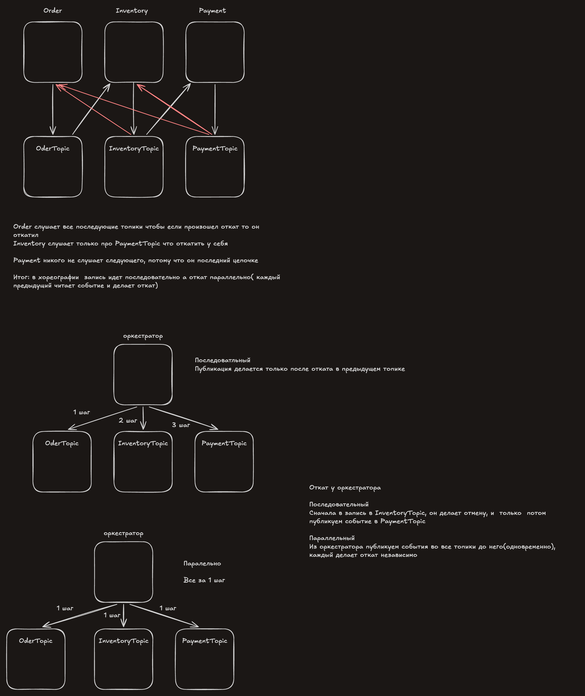

# День 15

**Проблема**
У нас три базы данных разделенны физически и мы не можем сделать коммит в две сразу 

Решение 
2PC - двух комитная транзакция
Saga - при неудаче в одном из сервисов, публикуем событие которые сделает компенсирующее  действие ( новой транзакцией )

Как идет запись при `Begin-Commit`
1) Записи идут в оперативной памяти в WAL buffers
2) Commit -> Сбрасываем с оперативной памяти на диск в Wal файл с статусом ("завершена") (видна другим)
3) Когда зафиксировали, только после этого даем пользователю ответ "успешно"

Как идет запись при `Begin-Prapare`
1)  Записи идут в оперативной памяти в WAL buffers
2) Prepare -> Сбрасываем с оперативной памяти на диск в Wal файл с статусом ("В ожидании") (не видна другим)
3) Когда зафиксировали, только после этого даем  пользователю  ответ "ждем подтверждения"
4) Commit -> меняем статус и говорим пользователю "успешно"

#### Почему 2PC не используют в микросервисах
##### Блокировка строки при отказе координатора
Если координатор упал, то заблокированная строка находится в ожидании и не знает сделать (коммит/rollback), теперь сервис хочет изменить и ждет пока строка освободится(каскадное падение)
##### Блокировки держатся долго
Время = самый долгий участник, координатор ждет ответа всех участников чтобы получить согласие(делать/наделать коммит)

##### Мы не можем контролировать БД внешних сервисов 
Мы не можем зайти в базу данных банка и сделать `commit-prepare`, ведь мы имеем только Эндпоинт по которому можно обращаться

##### Сервис лезет в чужие бд
Так как координатор лезет в чужие бд напрямую это нарушает правило (одна база данных на сервис), и любое изменение в базе несет за собой падение всех сервисов из за несовпадения контракта с бд.

#### Saga и компенсации

**Saga** -цепочка локальных транзакций
**Компенсация** - транзакция которая отменяет прошлую транзакцию противовесом 

**два требования к компенсации**
1) Должна поддерживаться идемпотентность, чтобы мы не могли сделать "противовесное действие" два раза
2) Не должна падать и фиксироваться окончательно, если зафиксировать, отказаться от отмены нельзя, иначе данные рассогласованные полностью

##### Как идет запрос 
Сервис1 публикует событие, Сервис2 его читает и публикует, Сервис3 читает и публикует
(синхронная цепочка вызова)

Как идет публикация событий при ошибке
V1) асинхронно  передаем с упавшего сервиса перед ним стоящему(*минус* в том что если какой то сервис упал в середине цепочки то сервисы перед ним все еще имеют неактуальные данные)
V2) Каждый сервис подписан на  все топики ошибок следующих сервисов если сервисов 6, то  первый подписан на 5 топиков(*минус* в том что очень много топиков)(больше подписчиков на один топик)

Минусы
1) Если поменять местами порядок то нужно менять зависящие сервисы 
2) Не видно полностью состояние ( нужно делать  запросы в бд всех сервисов, чтобы понять на какой ступени "компенсации" мы находимся)
3) Циклическая зависимость, каждый сервис привязан к событиям впереди идущих

**Хореография** - записали событие в outbox и  публикуем в топик, каждый сервис сам решает что делать

в хореографии  запись идет последовательно а откат параллельно( каждый предыдущий читает событие и делает откат)

**Orchestration** - Один сервис который подписан на все  топики  и относительно записывает сообщения в топик и консюмеры меняют состояние и записывают ответ в топик оркестратора.
- Оркестратор знает все топики сервисов, слушает только свой
- Сервис знает топик  оркестратора,  слушает только свой

|                         | Координатор 2PC                | Оркестратор                            |
| ----------------------- | ------------------------------ | -------------------------------------- |
| Участники фиксируют     | по его команде                 | сразу, сами                            |
| Блокировки у участников | держатся до фазы 2             | отпущены после своего COMMIT           |
| Как общается            | SQL в чужие БД                 | команды через Kafka / API              |
| Упал                    | участники висят с блокировками | участники работают, сага ждёт в его БД |

|                   | Хореография                    | Оркестрация                                                              |
| ----------------- | ------------------------------ | ------------------------------------------------------------------------ |
| Где порядок шагов | в подписках всех сервисов      | в одном оркестраторе                                                     |
| Состояние саги    | разбросано по БД               | одна строка `order_saga`                                                 |
| Зависшая сага     | никто не видит                 | таймаут по `deadline`                                                    |
| Связи             | каждый знает события следующих | участники знают только оркестратор                                       |
| Минус             | сложно менять и отлаживать     | лишний компонент, риск собрать всю логику в нём(больше сетевых запросов) |

### Итог дня: Saga

#### Теория

- **Проблема:** у каждой БД свой WAL и свой COMMIT. Зафиксированное нельзя откатить `ROLLBACK`, только новой транзакцией.
- **2PC:** `PREPARE TRANSACTION` (на диске, не видно, блокировки держатся) → `COMMIT PREPARED` / `ROLLBACK PREPARED`. Не подходит: при падении координатора участники висят с блокировками, блокировки живут время всех сетевых шагов, доступность перемножается, банк и Kafka не умеют PREPARE.(Каскадное падение, если мы обращаемся стороннему сервису то мы не можем захватить бд и сделать транзакцию)
- **Saga:** цепочка локальных транзакций + компенсации. Нет изоляции: промежуточное состояние видно всем. Компенсация идемпотентна и не может отказать по бизнес-причине.
- **Хореография** vs **оркестрация:** логика размазана по подпискам vs одна строка состояния у оркестратора. Зависшую сагу в хореографии никто не видит; в оркестрации её ловит `deadline` и ставит статус `canceled`. 

В хореографии запись идет последовательно а откат параллельно, сервис публикует событие, все сервисы до него читают это событие и делают откат.

В оркестрации запись тоже идет последовательно, но каждый шаг фиксируется в оркестраторе, откат может быть как параллельный(опубликовать события одновременно в несколько топиков, или делать отмену последовательно, как только  inventory говорит что отменил, мы публикуем событие в следующий топик)

Последовательно  = по одному шагу
Параллельно = публикуем во все топики за  один шаг

