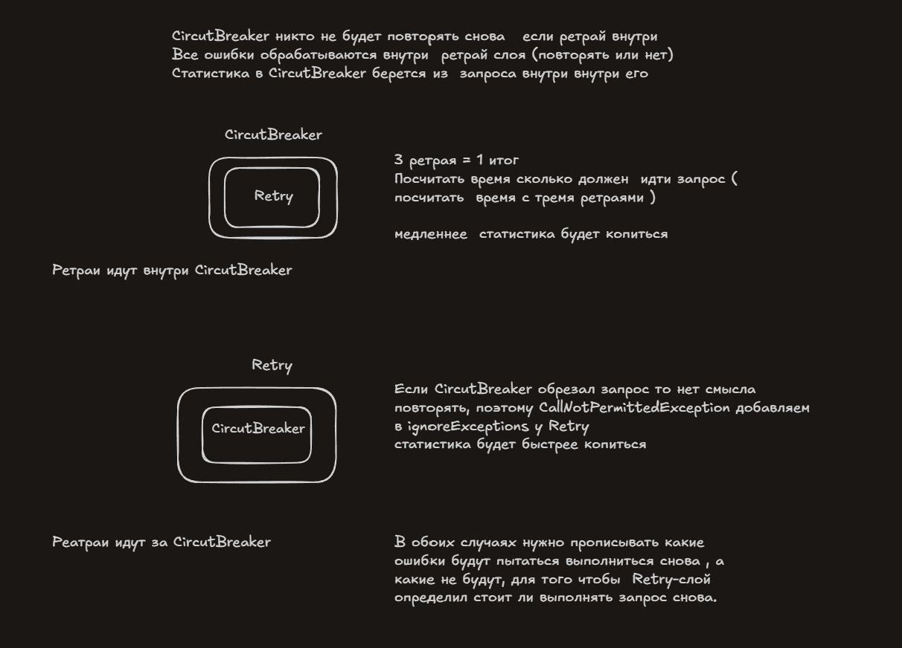

# День 19

**Retry strorm** - когда много повторных вызовов, и сервер  не  сервер не может  подняться из за перегрузки
Если каждый сервис будет делать  внутри себя ретрай то колличество запросов на  нижний слой  (будет равно умножению ретраев). Order делает 3 ретрая и внутри каждого  inventory делает 3  запроса к Payment, и того к  Payment 9 запросов.

**Наложение по времени** - Когда readTimeout меньше чем работа выполняемая с retry-ями,
и readTimeout обрывается и делает новый ретрай, а  прошлый работает в холостую.

##### Почему поток продолжает работать   когда внешний сервис прервал ожидание ?
GateAway -> Order -> Inventory
Order  делает запросы к Inventory, спустя 2с обрывает соединение с Order, Order узнает что соединение прервано  только  когда  попытается записать байты(уже после выполнения работы)

Решение Retry-Storm 
Нужно поставить ретрай только в одном месте (вызывающий сервис)

**retry budget** - бюджет ретраев, нужно сделать чтобы каждый ретрай перед тем как делать повторный запрос спрашивал, а могу ли я сделать повторный запрос.(обращается к редису если может то  делает если нет то не делает)
Логика:  Каждый первый запрос прибавляет 0.1 в общую копилку, если хочешь сделать запрос то тебе нужна "1", значит спустя 10 запросов сможешь сделать ретрай.

Берем вариант что 3 ретрая 
Миниум для подсчета OPEN = 10 сообщений

|                            | Retry(CB)                                                             | CB(Retry)                                                                       | Итог                                                                                                        |
| -------------------------- | --------------------------------------------------------------------- | ------------------------------------------------------------------------------- | ----------------------------------------------------------------------------------------------------------- |
| Нужно вызовов до OPEN      | 4                                                                     | 10                                                                              | CB открывает медленнее у CB(Retry)                                                                          |
| Частичные сбои (в ретраях) | Будет их видеть ибо каждя попытка  проходит через CB                  | Только итог вызова                                                              | Retry(CB) заполняется быстрее и статистика берется исходя из каждого вызова                                 |
|                            | вызов  напрямую (сколько  invnentory отвечал столько и потребовалось) | Нужно брать в расчет время покрывающее ретраи чтобы не оборвать  запрос заранее | CB(Retry) получается что время ожидания потока должно покрывать цепочку вызовов ретрая(поток в ожидании 4с) |
| CB(OPEN)                   | Делаются попытки (если не настроить)                                  | До ретрая даже не доходит                                                       | CB(retry) исключает вариант что при Open его  будут вызывть несколько раз                                   |

### ИТОГ:
**Retry(CB):** CB считает каждую попытку → OPEN быстрее, видит частичные сбои. `CallNotPermittedException` — в `ignoreExceptions` у Retry.
**CB(Retry):** CB считает итог серии → OPEN в k раз позже, частичные сбои маскируются.( потому что  чтобы запрос считался упавшим нужно чтобы все `retry` были  `fail`)

Retry допустим если ошбика связана с соединением то можно повторить.В ретрай указать `CallNotPermittedException` в `ignore`

CircutBreaker никто не будет повторять снова   если ретрай внутри
Все ошибки обрабатываются внутри  ретрай слоя (повторять или нет)
Статистика в CircutBreaker берется из  запроса внутри внутри его  

Нужно смотреть прописать что CircutBreaker будет считать за ошибку, и прописать что Retry будет повторять а что не будет повторять.

**Порядок решает одно**: что видит CB - каждую попытку(Retry снаружи),  или только итог (Retry внутри)

**Настройки решают остальное**: у Retry - что повторять, у CB что считать ошибкой

**Стандарт**: Retry снаружи, CB внутри  а  CallNotPermitedException у Retry.