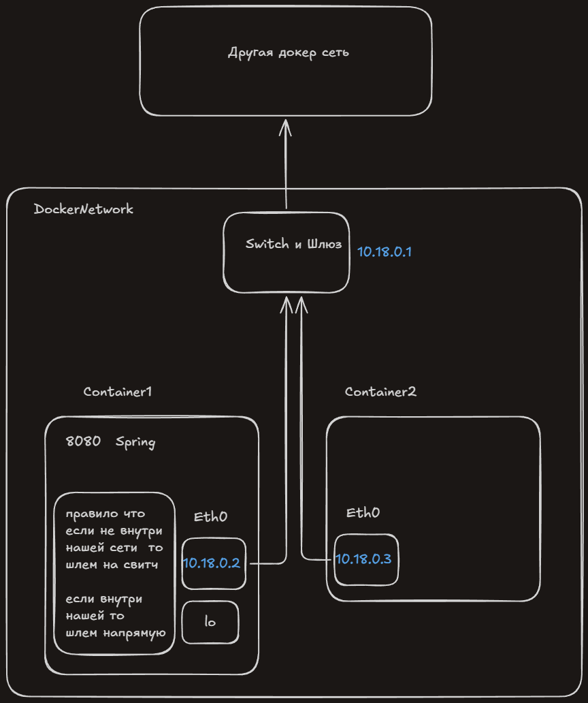
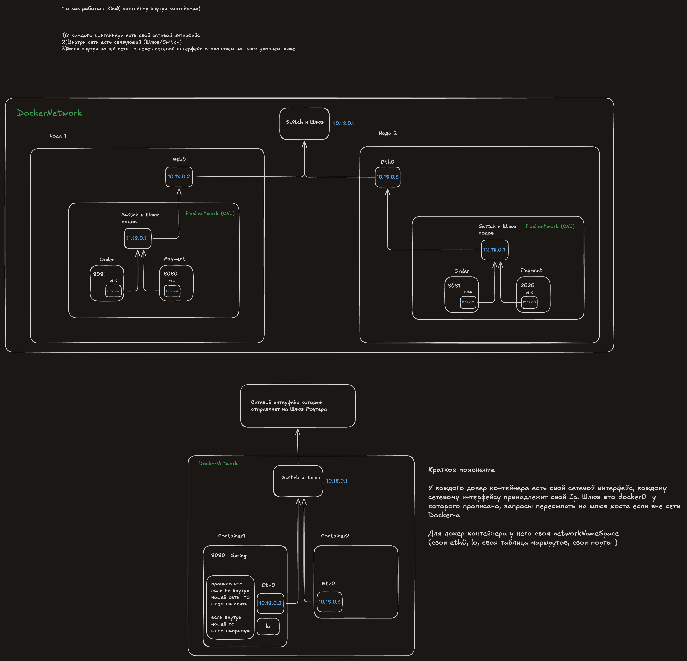

# День 20

## Docker

**Контейнер** - это обычный процесс Linux на ядре хоста, с своими nameSpace(PID, mount, network)
**Ядро операционной системы** - главная программа операционной системы которая имеет напрямую доступ к железу. Любой процесс который обращается к ядру, говорит что сделать, а делает ядро.

nameSpace - объект в ядре с собственными таблицами
- PID nameSpace - айди рабочих  процессов
- Mount nameSpace -mount(какие папки видит процесс )
- network namespes - набор сетевых таблиц ядра
Каждому  контейнеру докер выдает собственный Ip

**eth0** - cетевой интерфейс который имеет айпи адрес и MAC адрес , и который используют для связи с другими. Отправляем данные в docker0( любой наша запрос уходит  туда, связка ядра операционной системы). 

**Образ** - стопка слоёв, неизменяемый(является lowdir для всех следующих его наследователей)
**Слой** - файлы которые добавила или изменила одна инструкция Dockerfile (`COPY`, `ADD`, `RUN`); 
**Имя** = sha256 от содержимого; только чтение
**Контейнер** = образ  lowdir + пустой `upperdir` для записи.

ключ = хэш пред. слоя + данные  (если не совпало  то все действия ниже делаются заново)

##### Layered jar
**ClassLoader** - класс (который находит  байты и загружает их в JVM чтобы она сформировала класс в памяти)
Разложить jar на слои чтобы при смене в коде не копировать jar заново и не собирать образ

defaultClassLoader умеет читать только .class файлы с корневого пути, так  как в maven плагине мы их не переносим в другую папку в `BOOT-INF/classes/` то defaultClassLoader
не может его  прочитать.

Одинаковый путь + имя класса в двух библиотеках, получится что один файл про игнорируется.
Jar файл внутри другого jar файла, если classLoader не нашел среди моих классов, он читает метаданные jar файлов внутри(видит мой класс), идет в этот jar, забирает из него запись и загружает в память.

#### DockerNetwork
MAC адрес - идентификатор сетевого устройства

**vethPair** - пара виртуальных интерфейсов (из одной точки в другую точку)
Сетевой интерфейс - логика того как  пересылать байты и общаться
**docker0** - связующий, между контейнерами, получает МАС и по адресу знает в какой сетевой интерфейс передать
**dockerd** - связующий ДНС чтобы контейнеры обращались по именам а не по айпи

Сначала спрашиваем у `dockerd` айпи адресс inventory, потом  через ARP

**HealthCheck** - спрашиваем докер контейнер работает ли все корректно (0 - да, !0 = нет)
Настраиваем интервал, retry-es, сколько секунд пропустить (даем время на запуск контейнера)

**depends on** - один сервис запускается только когда запустился сервис от  которого  зависим
Работает только на этапе подъёма контейнера.
Правило: делаем `test` чтобы можно было понять когда контейнер `healthy` и можно запускать другой контейнер.

DockerИтог
Срезать этапы которые не входят в финальный билд, (уменьшить вес контейнера, оставить функционал  по минимуму).Разделить на слои чтобы редко изменяемые слои кэшировались тем самым уменьшали время сборки ( при следующей сборки  большинство этапов закэшированно и не  нужно заново воспроизводить)
(чем больше слоев закэшированно тем меньше нужно выполнять и сборка проходит быстрее)
В финальный образ идут только последние слои.

|                                 | Multistage                          | одноэтапный билд                                                                                                                |
| ------------------------------- | ----------------------------------- | ------------------------------------------------------------------------------------------------------------------------------- |
| Что скачано при всей сборке     | JDK, .m2(мавен зависимости), Maven, | JDK, .m2(мавен зависимости), Maven,                                                                                             |
| Что  осталось в итоговом образе | JRE(без компилятора) + jar          | JDK(чтобы скомпилировать), .m2(мавен зависимости), Maven(сам мавен чтобы зависимости скачать), jar (чтобы  запустить программу) |
| зависимости                     | jar                                 | jar + .m2                                                                                                                       |
Итог: `Multistage` финальное весит меньше.

#### Docker NetworkFinal
##### 1.Контейнер
Контейнер - обычный процесс только  со своими nameSpaces(PID, mount(какие папки видит процесс ), network).
##### 2.Интерфейсы
**eth0** - сетевой интерфейс, принимает и отправляет байты(ip принадлежит  ему) 
**lo** - связь "внутри себя" так приложения ходят друг к другу  различая по портам.
**veth**  - виртуальный провод: один конец eth0 в контейнере, другой  воткнут в свитч

IP принадлежит конкретному сетевому интерфейсу а не приложению. Приложения в контейнере делят один айпи адрес и  различаются портами 
##### 3.Куда отправить
**Таблица маршрутов** - правила подсети "в какой интерфейс отправить"
Получатель в нашей подсети  - шлем прямо  по MAC через Switch
Получатель не  в нашей подсети - шлем на шлюз
##### 4.Swtich и шлюз
Switch - доставка внутри  сети
Шлюз - выход  в другие сети( таблица маршрутов одна на все докер сети)

##### 5.Путь пакета наружу
Контейнер: адрес не из нашей подсети → шлём на шлюз (docker0, IP хоста 172.17.0.1).
Хост: по своей таблице маршрутов находит default → роутер.

Аналогия
Контейнер - компьютер
Роутер - Switch/Шлюз
Все тоже самое просто внутри  компьютера

