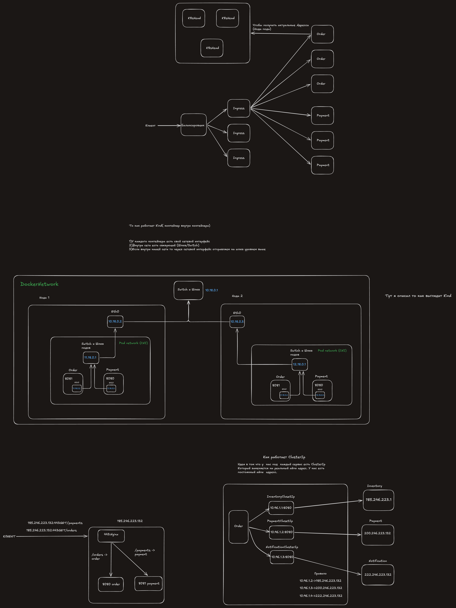

# День 22

**ConfigMap** — настройки в etcd. Через env читается один раз при старте, через файл обновляется на ходу

**Rollout** - дописать строчку в Template(описание контейнера), получается новый хеш, новый перезапуск, новые переменные окружения.

application.yaml -   получили файл и  записали его в  volume, контейнер  обращается к  файлу, файл  может  меняться во время работы.

Атомарня смена ссылки (при файле) - Создается вторая папка и потом  заменяется ссылка у data куда он ведет

**Secret** - записываем на сервер  зашифрованное поле(в etcd оно значение зашифровано), у кого есть права он расшифрует и отдаст в нормальном виде.(при включенном шифровании)

**tmpfs** — это файловая система, которая хранит файлы не на диске, а в оперативной памяти ноды.(Используется для secret)

**startupProbe** - Оно уже проснулось? (только при старте)
**livenessProbe** - оно  не упало  посреди работы( проверка на протижении всей работы раз в N секунд)
**readinessProbe** - оно  готово принимать запросы и обрабатывать (проверка на протяжении всей работы раз в N секунд)

**Actuator** - служебный модуль который открывает эндпоинты спринг приложения для проверки
- /actuator/health

**request** - сколько под бронирует памяти  ( пишется для scheduler чтобы он определили ноду )
**limits** - сколько максимум памяти может взять под, сколько максиму под может использовать процессор 
- в случае с памятью приложение ОС останавливает(OOMKilled)
- в случае с процессором Ядро временно снимает работу пода с процессора до следующего отрезка 

**Лимит задан** — процесс гарантировано не сможет взять больше памяти чем указано в лимите. 
**Лимит не задан** — процесс заберет вообще всю доступную оперативку на сервере, пока не упрется в лимит всей оперативной памяти.

**cgGroup** - ограничения в ресурсах процесса
с  Java10 сделали что  джава мыслит не в контексте всей памяти, а в  контексте cgGroup

**Ingress Controller**  - под с Nginx где  происходит фильтрация куда  отправить запрос(стоит впереди)
внешние запросы ссылаются на него ( айпи всегда один и тот же)

**Ingress** - правила записанные в Kubernetes (/order -> order, /payment -> payment)

с kub-proxy мы достучимся, но  мы не можем контролировать куда идет запрос(этим не  мы занимаемся). с Controller может взять  запрос и сам выбрать куда переслать.

Order знает несколько ClusterIp(payment, notificcation, inventory)

Чем Kubernetes похож на Eureka

| Eureka                 | Kubernetes                                                                                                                                          |
| ---------------------- | --------------------------------------------------------------------------------------------------------------------------------------------------- |
| регистрация            | Регистрация сервисов, он сам  регистрирует каждый под в системе ( его айпи и состояние)                                                             |
| heartbeat + аренда     | Состояние контролируется через probes + Leas ноды                                                                                                   |
| снятие с учёта         | Снятие с учета,  если  не проходит readness,liveness то  под  автоматически перестает быть в списках ready и EndpointSlice его не использует        |
| кэш списка у клиента   | Клиенту не нужно держать хеш(список клиентов и  обновлять его), мы пишем только имя а уже актуальными путями занимается (Kub-proxy + EndpointSlice) |
| выбор экземпляра в JVM | Выбор экземпляра, не мы выбираем, у нас всегда один адресс  а едро ноды выбирает по ClusterIp                                                       |
headless Service - когда балансирует не Сервер а клиент получает все пути и сам делает балансировку 

Мапинг происходит по метке label: app()
Создал yaml файл, указал откуда брать env переменные ( metadata:name нашего ямл файл где есть конфигурация)

`port` -  создаем правило что когда в коде обращаемся на ClusterIp:`port`  то запрос пересылается на PodIp:`targetPort`

### Итог:
Secret — пароли и ключи. Файлом он лежит в tmpfs, в оперативке ноды
ConfigMap - yaml файл в котором указаны переменные окружения, может быть несколько.Имеет атомарную запись (смена ссылки на содержимое папки).Применяются при старте контейнера.( либо через файл либо сразу через переменнные окружения)
StartupProbe - отдельное время на фазу старта 
(requests/limits) - ограничения на  Scheduler и ограничения на самом хосте (сколько mem+cpu)
Ingress - шлем запросы на отдельный под который балансирует трафик 

Service+DNS - ClusterIp(с правилами в ipTable) - ОС выбирает куда слать запрос
Отдельный под - отдаем запросы на его ip(балансирует под) 

- Научился писать Secret файлы,
- записывать переменные окружения через файлы,
- убедился что preStop гарантирует что все запросы пройдут без ошибки при удалении контейнера
- Понял что сервис знает каждый сервис  ClusterIp, шлет запрос и у него происходит подмена.

Стандартный пайплайн
1) Создал докер образ -> загрузил его в Kubernetes
2) Сделал yaml файл с настройками(указать имя и сервисы которые нужны для ДНС)
3) apply 
4) у нас поднятый контейнер с нужной нам логикой

