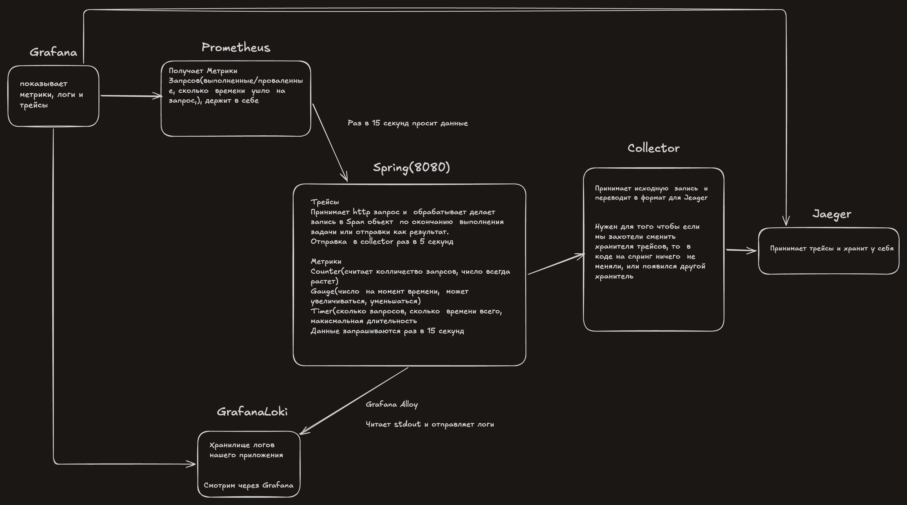

# День 23

Проблемы без мониторинга, чтобы понять где конкретно завис запрос, нужно чекать логи всех сервисов через которые прошел запрос.

**Лог** — строка на каждое событие, пишется в stdout:
- **GrafanaLoki** - логи  записываются в отдельное хранилище
**Метрика** - показатель по которому считываем состояние системы(Сколько  запросов успешно, сколько проваленных)
- Prometheus (хранилище  метрик)
**trace** - запись пути одного  запроса ( у каждого  запроса есть время начала и время окончания), у запроса есть один айдишник ( по нему и строится  трейс)
- Collector -> Jaeger, Tempo(хранилище  с OpenTelemetry для записи в  любое хранилище  )

**Micrometer** -  Прослойка куда записывают  данные (чтобы не переводить в  определенный формат  системы мониторинга)

#### Виды Метрик
**Counter** - счетчик  который считает сколько раз  случилось событие
**Gauge** - значение прямо сейчас( может расти, может уменьшаться(количество свободных потоков))
**Timer** -   счетчик времени числа (max, TotalTime, count)

**Prometheus**  - каждые 15 секунд сохраняет числа метрик, сам приходит.
Prometheus спрашивает каждую реплику отдельно ( у каждой своя строка )
(время, репликаId, значение)

Ряд - уникальная комбинация меток только значения  с низкой кардинальностью (status, method) 

Метрика нужна  чтобы видеть общую картину по группам. Метки это признак  группы с низкой кардинальностью. 

**Гистограма** - набор счётчиков(корзины) с границей.(не больше 500мс)
Корзина - тут написано количество  запросов с заданной границей выполнения

**MDC** - map привязанный к текущему потоку, достаточно записать: ключ и в любой функции  можно получить orderId, не передавая в функцию ( хранится внутри потока )

**Span** — одна операция в одном сервисе(внутри одного сервиса)
**traceId** - айдишник который дается запросу в начале пути и проходит через всю  цепочку
**spanid** - айдишник операции внутри  запроса
**ParentSpanId** - айди операция которая вызвала текущуюю
**start,duration**- дата начала, и время(сколько  шло)

W3C Trace Context - стандарт  чтобы библиотеки понимали один заголовок `traceparent`
#### OpenTelemetry
**Otlp** - OpenTelemetryProtocol
**OpenTelemetry** - единый формат записи трейсов который мы отправляем в Collector
**Collector** - отдельный под, который принимает span в формате  OpenTelemetry и переводит на любой вид хранилища трейсеров.
**Micrometer Observation** - сообщает подписанным обработчикам «операция началась / закончилась». (запись для метрик + запись в collector). Иначе пришлось бы писать  логику замера выполнения через Micrometer(метрики), и для трейсов (OTel)

Трейсер - (храним трейс айди, Spanid, время), так мы понимаем какой этап конкретно выполняется дольше всего 

BatchSpanProcessor - идея в том чтобы записать Span-ы в пачку, и отправить одним разом , а не во время потока который выполняет бизнес логику.
- Collector недоступен -  выбрасываем наши трейсы, трейсы потеряны зато сервис не  пострадал
- Остановка приложение -> делаем flush(перед остановкой отправляем трейсы)

**HeadSampling** - решение принимается в начале в корневом Span.

**Tail sampling** - решение в конце, Collector ждет все события по TraceId(10с) если нет  ошибки то отбрасывает. Цена - в памяти которую должен одновременно держать Collector.

Пайплайн если медленный запрос 
1) Grafana — видим, у какого endpoint вырос p95 
2) (Jaeger) Смотрим Полный путь Trace и видит на каком Span медленная часть
3) (GrafanaLoki) - чекаем логи сервиса что  замедлило конкретно

RestClient.Builder — Spring добавляет перехватчик, который кладёт traceparent в исходящий запрос
#### Метрики
Метрика (counter, Gauge, Timer) общее  число, отдельные запросы теряются
Meter - объект одной метрики (Counter, Gauge, Timer)

Promethouse - хранилище куда метрики  складываются
Гистограмма - Коризны с границами по времени(le)
rate -  насколько счетчик растет в среднем в секунду
Перецентиль - значение меньше которого процент всех значений (p95 - меньше него  95%)
query_range - посчитай формулу за промежуток.

Логи и трейсы
MDC - map в памяти потока, обязательная чистка в конце выполнения, чтобы другой поток не взял чужой TraceId.
Span: `traceId`/`spanId`/`parentSpanId` длительность  по часам одной машины(которая меряет так что неважно насколько разница),
TraceId - заголовок в HTTP, kafka чтобы можно было увидеть путь запроса,
Outbox рвёт трейс - нужно взять  `traceparent` который положили в бд, чтобы взять TraceId а не новый который сделал Спринг для потока.
OpenTelemetry - формат(прослойка) который перевод запись в любой формат для трейсов.Collector принимает и уже мапит под любое хранилище
BatchSpanProcessor - храним у себя Span, потом одной пачкой отправляем в Jaeger
Head sampling - решение у корня  записывать ли этот трейс
Tail sampling - решение уже прямо в Collector (передавать в Jaeger или нет)

### Итог
Метрики являются общий числом за  временный промежуток (Counter), так что нет конкретики.  
Micrometer ->Prometheus ->Grafana
**Trace**
Нужно  записывать одинаковый TraceId и контролировать каждый момент чтобы на другом сервисе не разьеденился TraceId. 
OpenTelemetry->Collector -> Geager 
**Http** 
Подключив библиотеку  MicrometterTracing, Если инструментария есть но метод  который принимает  сообщения есть  и никто не передал то Спринг сам создаст Span+TraceId.
Kaffka
spring.kafka.template.observation-enabled=true
spring.kafka.listener.observation-enabled=true

мини зарисовка работы 

